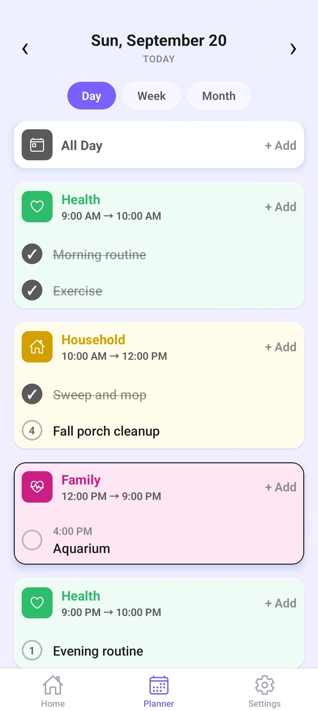

# Tessera: Marketing Site

The marketing and beta sign-up site for **Tessera**, a mindful daily planner for iOS and Android that helps people build balance across every area of life.

**Live site:** [tesseraplanner.app](https://www.tesseraplanner.app)



## About Tessera

Most people plan their lives across a dozen disconnected tools. Tessera replaces them with one planner built around a simple idea: your life isn't a list, it's a mosaic. Each area of life (work, health, family and so on) becomes a tile, a weekly template gives each area its time, and the planner fills in every day automatically.

The Tessera app itself is built with React Native, Expo, TypeScript and Supabase. **Its source code is private, but available to review upon request.** This repo contains the public marketing site.

## What's in this repo

| Route | Purpose |
|---|---|
| `/` | Landing page: features, how it works, app screenshots, beta tester quotes and beta sign-up |
| `/privacy` | Privacy policy |
| `/account-deletion` | Account deletion instructions (required for the Google Play listing) |
| `/unsubscribed` | Confirmation page for email unsubscribes |

Notable details:

- **Next.js App Router** with React Server Components and typed `metadata` for each page.
- **Generated share image.** `app/opengraph-image.tsx` renders the Open Graph image on the edge runtime, so link previews always match the current branding.
- **Beta sign-up by platform.** Visitors choose iOS (TestFlight) or Android (Google Play testing) through a shared `PlatformLinks` component.
- **Responsive app showcase.** Real app screenshots are presented in a reusable `PhoneFrame` component.

## Stack

- [Next.js 14](https://nextjs.org) (App Router) and React 18
- TypeScript
- Tailwind CSS
- Deployed on [Vercel](https://vercel.com) with Vercel Analytics

## Run it locally

```bash
npm install
npm run dev
```

Then open [http://localhost:3000](http://localhost:3000).

## Project structure

```
app/            # routes, layout, global styles and the generated share image
components/     # PhoneFrame, PlatformLinks, TesseraLogo
public/         # app screenshots
play-store/     # Google Play listing graphics
```

---

Built by [Kyra Thomas](https://kyrasdigitalsolutions.com) of Kyra's Digital Solutions.
